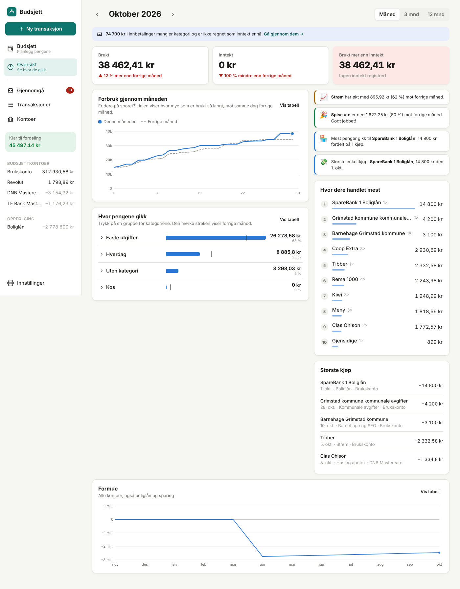
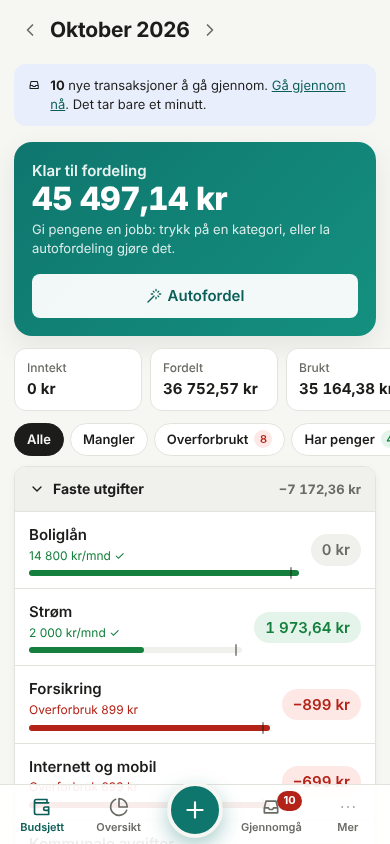
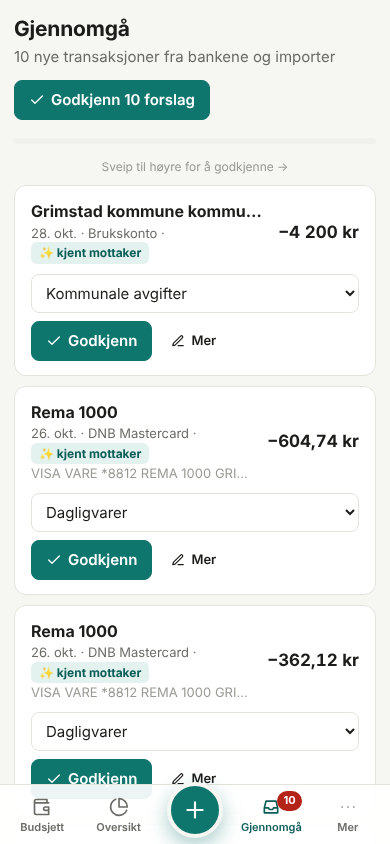

# Budsjett

En budsjettapp for husstanden, laget for norske banker. Den budsjetterer som YNAB, er like enkel som EveryDollar, og har
gjennomgangsinnboks og innsikt som Copilot og Monarch. Transaksjonene kan komme fra **automatisk banksynkronisering (BankID)**,
**CSV-import** eller **manuell føring**, og hver konto kan bruke sin egen metode. Alt går gjennom den samme smarte løypa.

<p>  </p>

## Hva appen gjør

To hovedfaner:
- **Budsjett**: styr pengene. Gi hver krone en jobb, se hva som er igjen i hver kategori, og fiks overforbruk med ett trykk.
- **Oversikt**: se hvor pengene faktisk gikk. Brukt og inntekt mot forrige periode, forbruk gjennom måneden, kategorier, butikker
  dere handler mest i, største kjøp og formue.

På PC får du tabell og sidepanel. På mobil får du store trykkflater, bunnark, en «+»-knapp for raske kjøp og sveip for å godkjenne.

**Budsjettering (som YNAB)**
- *Klar til fordeling*: inntekten havner her, og dere gir hver krone en jobb. Kommer lønnen den 20. eller 25., kan dere
  fordele den til neste måned.
- Det som er igjen i en kategori, blir med til neste måned. Overforbruk vises i rødt med *Dekk overforbruket* med ett klikk.
- Kredittkort fungerer naturlig: kjøp med DNB- eller TF Bank-kortet er forbruk, og å betale kortet fra SpareBank 1 er bare en
  overføring.
- **Mål**: fast beløp hver måned, spar et beløp til en dato (fordelt jevnt på månedene som er igjen), eller hold en saldo.
- **Autofordeling**: fyll opp målene, kopier forrige måned, eller bruk forrige måneds forbruk eller snittet for tre måneder.
- **Tempostreker** viser om en kategori brukes raskere enn vanlig så langt i måneden.
- *Flytt penger* mellom kategorier med to klikk.

**Slik kommer transaksjonene inn**
- **Banksynkronisering** via [Enable Banking](https://enablebanking.com) (DNB, SpareBank 1, Revolut og de fleste europeiske
  banker) eller **SpareBank 1 sitt eget gratis API**. Synkroniserer hver fjerde time og varsler en uke før BankID-samtykket
  utløper.
- **CSV-import** som kjenner igjen filer fra SpareBank 1, DNB og Revolut. Den forstår `1 234,56`, filer i Windows-1252 (æøå),
  egne inn/ut-kolonner og kredittkortfiler med snudd fortegn. Det er trygt å importere samme fil to ganger.
- **Manuell føring** for kontanter. Når banken senere melder det samme kjøpet, kobles de sammen i stedet for å telles to ganger.

**Smart løype (for alle kilder)**
- Bankrot blir et lesbart navn: `VISA VARE *1234 12.10 NOK 349,90 REMA 1000 GRIMSTAD` → `Rema 1000`.
- Kategoriforslag fra reglene deres, deretter fra det dere valgte sist, og til slutt fra rundt 100 kjente norske butikker og
  leverandører (Rema, Kiwi, Tibber, Gjensidige, Ruter, Wolt …).
- **Overføringer oppdages**: påfyll fra SpareBank 1 til Revolut og betaling av kredittkortet kjennes igjen på begge sider og
  telles ikke som forbruk.
- Duplikater fjernes på tvers av kilder (det går fint å bruke både banksynkronisering og CSV på samme konto).

**Gjennomgå**: nye transaksjoner venter her med en foreslått kategori. Godkjenn én og én eller alle samtidig. Hak av for
*Alltid* for å lage en regel. Velger dere kategori for en mottaker, oppdateres de andre ventende transaksjonene fra samme mottaker
også.

**I tillegg**: oppdeling av transaksjoner, kommende regninger funnet i historikken, rapporter (forbruk mot det vanlige, inntekt
mot forbruk, formue), oppfølgingskontoer (boliglån, BSU), fungerer på mobil (kan legges på hjemskjermen som en app), mørk modus
og valgfritt passord for husstanden.

## Gratis på Cloudflare (uten egen PC)

Appen kjører gratis på Cloudflare Workers. Dataene ligger i en Durable Object med innebygd SQLite, og banksynkroniseringen
kjøres av Cloudflare hver fjerde time. Alt kan settes opp fra mobilen:

1. Gå til [dash.cloudflare.com](https://dash.cloudflare.com) → **Workers & Pages** → **Create** → **Import a repository**.
2. Koble til GitHub og velg `MimirVision/Budget`.
3. Kall prosjektet **`budget`** (må være likt `name` i `wrangler.jsonc`). La byggekommandoen være `npm run build` og
   deploy-kommandoen `npx wrangler deploy`. Trykk **Deploy**.
4. Appen ligger nå på **https://budget.&lt;ditt-subdomene&gt;.workers.dev**. Hver gang `main` endres, bygges og publiseres den
   automatisk.
5. **Lås appen**, siden den inneholder bankdata. Velg én av disse:
   - *Anbefalt:* Worker → **Settings → Domains & Routes** → workers.dev → slå på **Cloudflare Access**, og legg inn
     e-postadressene deres. Da får bare dere tilgang, med engangskode på e-post.
   - Eller: Worker → **Settings → Variables and Secrets** → legg til hemmeligheten `APP_PASSWORD`.
6. Valgfritt: legg til variabelen `PUBLIC_URL` med adressen fra punkt 4. Ellers finner appen den selv.

Gratisplanen gir rundt 10 ms CPU per forespørsel, så store jobber (CSV-import, «Godkjenn alle», første synkronisering) deles
automatisk opp i små biter. Cloudflare tillater 5 planlagte jobber (cron) per konto på gratisplanen. Appen bruker én.

## Kjør appen på egen maskin

Krever Node.js 22.13 eller nyere (bruker den innebygde SQLite-støtten).

```bash
npm install
cp .env.example .env        # valgfritt
npm run dev                 # nettsiden på http://localhost:5173, API på :8787
```

Vil dere prøve først? Last inn seks måneder med demodata:

```bash
DATA_DIR=./data/demo npx tsx scripts/demo.ts
DATA_DIR=./data/demo npm run dev
```

Produksjon (f.eks. på en Raspberry Pi eller hjemmeserver):

```bash
npm run build
npm start                   # serverer app og API på PORT (standard 8787)
```

Sett `PUBLIC_URL` til adressen dere åpner appen på (banken sender dere tilbake dit etter BankID), og sett `APP_PASSWORD` hvis
appen er tilgjengelig fra internett. Dataene ligger i `DATA_DIR/budget.db`. Ta sikkerhetskopi av den ene filen.

## Koble til bankene

Åpne **Innstillinger → Banksynkronisering** i appen. Der står det steg for steg hva dere skal gjøre, og nøyaktig hvilken
redirect-URL dere skal registrere.

| Bank | Anbefalt vei |
| --- | --- |
| SpareBank 1 Sør-Norge | Enable Banking, eller *SpareBank 1 (direkte)* via developer.sparebank1.no → Personlig klient |
| DNB kredittkort | Enable Banking |
| Revolut | Enable Banking (eller CSV-eksport fra appen) |
| TF Bank kredittkort | Enable Banking hvis kortet står i banklisten, ellers CSV-import |

Bankene krever at dere bekrefter med BankID på nytt omtrent hver 90.–180. dag. Appen minner dere på det og har en *Forny*-knapp.

## Utvikling

```bash
npm test          # budsjettregning, CSV-lesing, navnerydding, duplikater, overføringer
npm run typecheck
```

- `server/` (Hono; `node:sqlite` lokalt, Durable Object-SQLite på Cloudflare via `worker.ts`): `budget.ts` (konvoluttregning), `ingest.ts` (løypa), `payees.ts`, `import/csv.ts`,
  `sync/` (bankleverandører), `reports.ts`, `api.ts`
- `web/` (React + Vite): sider for Budsjett, Gjennomgå, Transaksjoner, Kontoer, Rapporter og Innstillinger
- Penger lagres som heltall i øre overalt.
