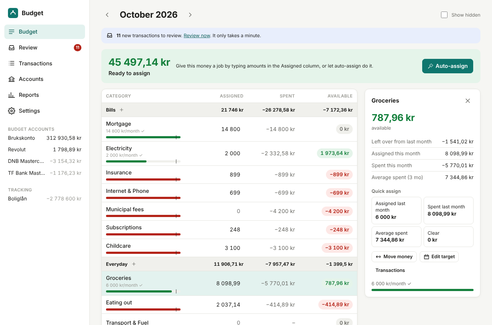

# Budget

A household budgeting app for Norwegian banks. It budgets like YNAB, keeps EveryDollar's simplicity, and borrows the review inbox
and insights from Copilot and Monarch. Transactions can come from **automatic bank sync (BankID)**, **CSV import** or **manual
entry**, in any mix per account. They all go through the same smart pipeline.

<p> </p>

## What it does

**Budgeting (YNAB style)**
- *Ready to assign*: income lands here and you give every krone a job. If your salary arrives on the 20th or 25th, you can assign
  it to next month.
- Leftovers roll over automatically. Overspending shows in red with a one-click *Cover overspending*.
- Credit cards work naturally: spending on the DNB or TF Bank card is spending, and paying the card from SpareBank 1 is just a
  transfer.
- **Targets**: monthly amount, save X by a date (spread evenly over the months left), or keep a balance.
- **Auto-assign**: fund targets, copy last month, use last month's or the 3-month average spending.
- **Pace bars**: see at a glance if a category is being spent faster than usual for this point in the month.
- *Move money* between categories in two clicks.

**Getting transactions in**
- **Bank sync** through [Enable Banking](https://enablebanking.com) (DNB, SpareBank 1, Revolut and most European banks) or
  **SpareBank 1's own free API**. Syncs every 4 hours and warns a week before the BankID consent expires.
- **CSV import** that recognises SpareBank 1, DNB and Revolut exports, handles `1 234,56` amounts, Windows-1252 files (æøå),
  separate in/out columns and credit card exports with flipped signs. Re-importing the same file is safe.
- **Manual entry** for cash. When the bank later reports the same purchase, it's matched instead of duplicated.

**Smart pipeline (for every source)**
- Bank gibberish → clean payee: `VISA VARE *1234 12.10 NOK 349,90 REMA 1000 GRIMSTAD` → `Rema 1000`.
- Category suggestions from your rules, then from what you picked last time, then from ~100 known Norwegian merchants (Rema,
  Kiwi, Tibber, Gjensidige, Ruter, Wolt, …).
- **Transfer detection**: the SpareBank 1 → Revolut top-up or the credit card payment is spotted on both sides and isn't counted as
  spending.
- Deduplication across sources (bank sync + CSV for the same account is fine).

**Review inbox**: new transactions wait here with a suggested category. Approve one at a time or all at once. Tick *Always* to
create a rule. Pick a category once for a payee and the other waiting transactions from that payee update too.

**Also**: split transactions, upcoming bills detected from history, reports (spending vs. your usual, income vs. spending, net
worth), tracking accounts (mortgage, BSU), works on phones (installable as an app from the browser's "Add to Home Screen"),
dark mode, optional household password.

## Run it

Requires Node.js 22.13 or newer (uses the built-in SQLite).

```bash
npm install
cp .env.example .env        # optional
npm run dev                 # web on http://localhost:5173, API on :8787
```

Want to click around first? Load six months of demo data:

```bash
DATA_DIR=./data/demo npx tsx scripts/demo.ts
DATA_DIR=./data/demo npm run dev
```

Production (e.g. on a Raspberry Pi or home server):

```bash
npm run build
npm start                   # serves app + API on PORT (default 8787)
```

Set `PUBLIC_URL` to the address you open the app on (the bank redirects back there after BankID), and set `APP_PASSWORD` if the
app is reachable from the internet. Data lives in `DATA_DIR/budget.db`. Back up that one file.

## Connecting your banks

Open **Settings → Bank sync** in the app. It has step-by-step instructions and shows the exact redirect URL to register.

| Bank | Suggested route |
| --- | --- |
| SpareBank 1 Sør-Norge | Enable Banking, or *SpareBank 1 (direct)* via developersparebank1.no → Personlig klient |
| DNB credit card | Enable Banking |
| Revolut | Enable Banking (or CSV export from the app) |
| TF Bank credit card | Enable Banking if it appears in the bank list, otherwise CSV import |

Banks require you to confirm again with BankID every 90–180 days. The app reminds you and has a one-click *Renew*.

## Development

```bash
npm test          # budget maths, CSV parsing, payee cleaning, dedupe, transfers
npm run typecheck
```

- `server/` (Hono + `node:sqlite`): `budget.ts` (envelope maths), `ingest.ts` (the pipeline), `payees.ts`, `import/csv.ts`,
  `sync/` (bank providers), `reports.ts`, `api.ts`
- `web/` (React + Vite): pages for Budget, Review, Transactions, Accounts, Reports, Settings
- Money is stored as integer øre everywhere.
